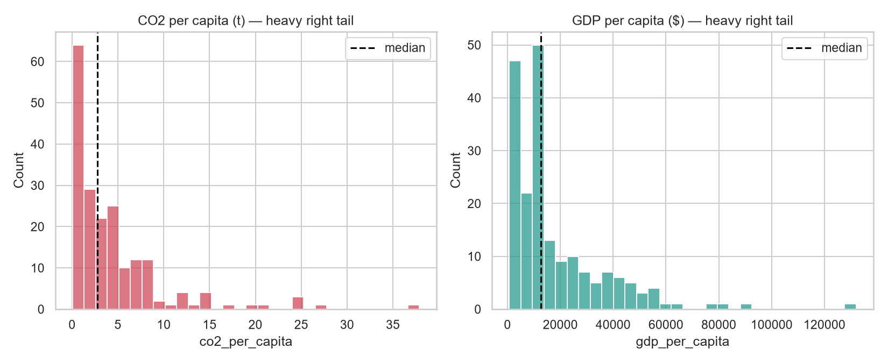
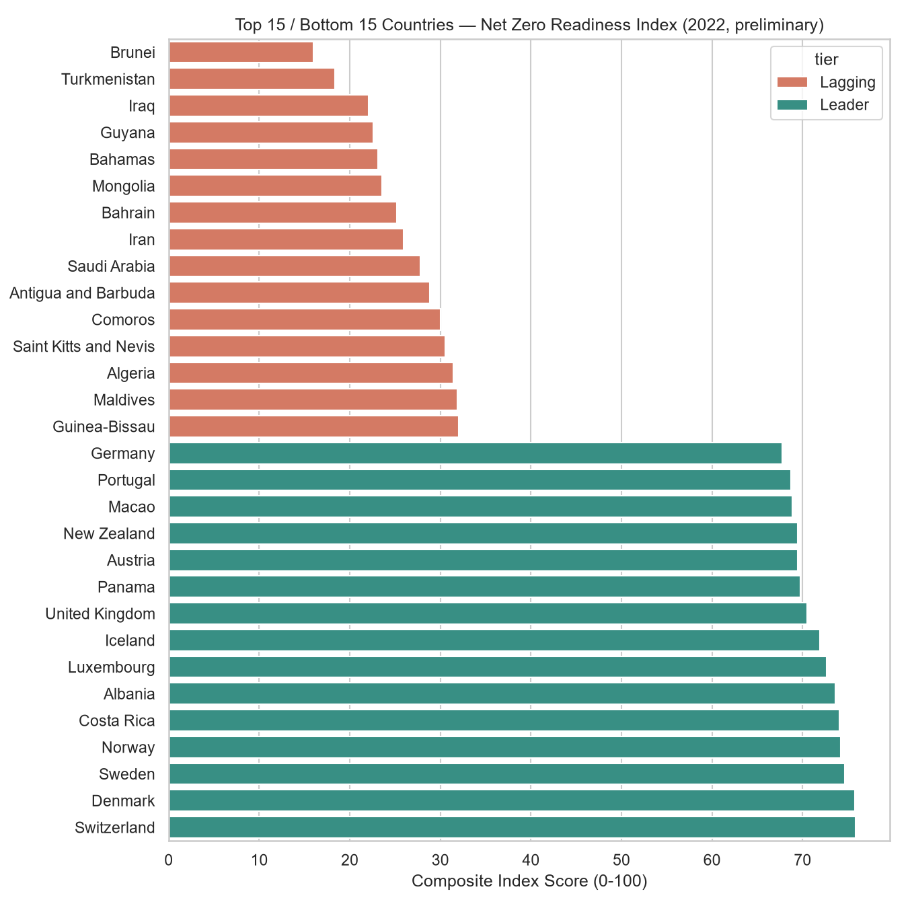
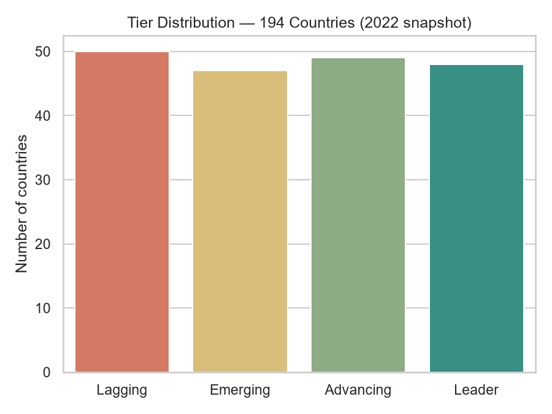
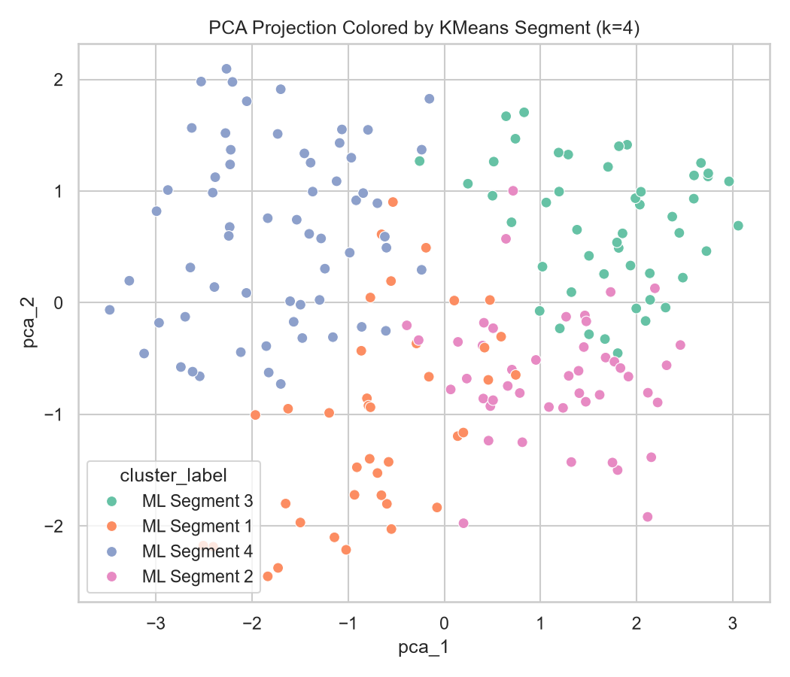
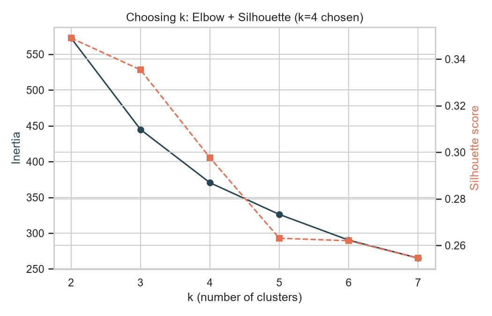
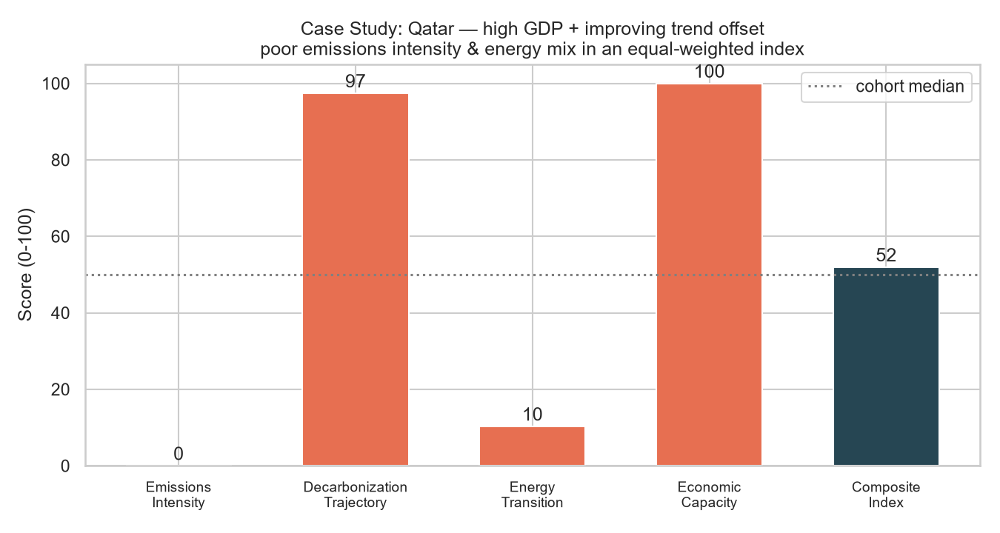

# NetZeroAI: An AI-Based Framework for Net Zero Readiness Assessment

**DA1 Progress Review — Work Completed So Far**
Status: **~60% complete** — data pipeline and preliminary ML results are working; index
validation, limitations analysis, and final reporting are still in progress (see "Remaining
Work" at the end).

Author: Sarvesh

---

## 1. Problem Statement & Objectives

Build an AI-based framework that assesses countries' readiness for Net Zero emissions
targets, combining:

- A composite **Net Zero Readiness Index** built from real climate/energy indicators
- **Unsupervised ML** (PCA + clustering) to independently segment countries and cross-check
  the index
- An **interactive dashboard** to explore rankings, country detail, and methodology

Scope note: this is a single-analyst project, not enterprise MLOps — the emphasis is on a
defensible, transparent methodology over infrastructure scale.

---

## 2. Data Sources

- **Our World in Data — CO2 & GHG dataset** (`owid/co2-data`): emissions, per-capita/per-GDP
  intensity, population, GDP, 1750–2024.
- **Our World in Data — Energy dataset** (`owid/energy-data`): electricity mix, renewables
  share, fossil/energy consumption, 1900–2025.

Both are widely-used, publicly documented sources, giving the index a real, verifiable
data foundation.

---

## 3. Data Preparation Pipeline

Key, independently-verified data decisions:

- **Reference year: 2022** (2023 has zero GDP data in both raw sources).
- "Real country" filter: `iso_code` matches `^[A-Z]{3}$`, minus a manual exclusion for
  Antarctica (`ATA` passes the regex but isn't a country). Kosovo has no valid `iso_code` in
  these files and is excluded as an accepted side effect.
- Merging CO2 + Energy data on `iso_code` at 2022 → **205 countries**.
- Added a computed **2013–2022 CO2-per-capita trend slope** (linear regression, not an
  endpoint delta — robust to one-off anomalies like the 2020 COVID emissions dip).
- Dropped countries missing more than 1 of the 5 chosen indicators → **194 countries** in the
  final table. The 11 dropped are almost all uninhabited/micro-territories (Bermuda,
  Curaçao, Faroe Islands, French Polynesia, Greenland, Micronesia, Montserrat, New
  Caledonia, Niue, Saint Pierre and Miquelon, Tuvalu).
- Remaining gaps (mostly GDP) filled with the cohort median, flagged per-country as imputed.

---

## 4. Index Design Methodology

**Five indicators across four equally-weighted dimensions:**

| Dimension                  | Indicator(s)                       | Direction              |
| -------------------------- | ---------------------------------- | ---------------------- |
| Emissions Intensity        | `co2_per_capita`, `ghg_per_capita` | lower = better         |
| Decarbonization Trajectory | 2013–2022 CO2/capita trend slope   | more negative = better |
| Energy Transition          | `renewables_share_elec`            | higher = better        |
| Economic Capacity          | `gdp_per_capita`                   | higher = better        |

**Normalization: percentile rank, not min-max.** The indicators are heavy-tailed —
CO2/capita ranges 0.06–37.9 t and GDP/capita ranges ~$689–$131,991 — so min-max scaling
would let a single outlier (e.g. Qatar, or a high-GDP microstate) compress every other
country's score toward zero. Percentile rank is outlier-robust and reads naturally ("better
than X% of countries").

Dimension scores are averaged (equal weight within a dimension), then combined into a single
0–100 **composite index** with equal 25/25/25/25 weighting across dimensions — the simplest,
least-arbitrary default in the absence of any validated expert-weighting scheme. Countries
are split into four tiers (**Lagging / Emerging / Advancing / Leader**) via quantile cuts of
the composite score.

---

## 5. Preliminary Results

At this stage, high-income countries with strong hydro/nuclear/renewable electricity grids
(Switzerland, Denmark, Sweden, Norway, Costa Rica) cluster at the top; countries combining
high emissions intensity with a fossil-heavy electricity mix (Brunei, Turkmenistan, Iraq)
cluster at the bottom. Tier sizes are roughly balanced (~47–50 countries per tier), as
expected from a quantile-based split.

---

## 6. ML Layer: PCA & Clustering (Independent Cross-Check)

To validate the index isn't an arbitrary artifact of the chosen weights, the same 5
normalized indicators are also fed into **PCA (2 components) + KMeans clustering**, entirely
independent of the composite score formula.

The dashboard cross-tabulates cluster membership against index-derived tiers to check how
well the two independent views agree — this cross-tab is one of the validation steps still
being finalized (see Remaining Work).

---

## 7. Case Study: Interpreting a Counter-Intuitive Result (Qatar)

Qatar illustrates both the value and a known limitation of the current methodology. Despite
having the **highest CO2-per-capita in the entire dataset**, Qatar lands in the middle
**"Advancing"** tier rather than "Lagging":

This is real, traceable signal, not a bug: Qatar scores 0/100 on emissions intensity and only
10/100 on energy transition (both correctly reflecting the underlying data), but 100/100 on
economic capacity (highest GDP/capita in the dataset) and 97/100 on decarbonization
trajectory (a steep per-capita emissions decline as population growth has outpaced absolute
emissions growth). Under **equal** dimension weighting, a wealthy-but-carbon-intensive economy
can still score moderately overall. This is a well-known critique of naive composite indices
in general, and is being carried forward explicitly as a discussion point rather than
papered over.

## 9. Remaining Work (~40%)

This submission reflects the working data pipeline and preliminary index/clustering
results — **not a finished project.** Still to be done:

- [ ] Sensitivity analysis: how much do country rankings shift under alternative dimension
      weightings (not just equal 25/25/25/25)?
- [ ] Deeper validation of the tier ↔ cluster agreement (quantify agreement rate, investigate
      disagreements)
- [ ] Polish the interactive Streamlit dashboard (currently functional, not yet
      presentation-ready) and add the live dimension-reweighting sliders
- [ ] Investigate a region/continent lookup to enable region-aware missing-data imputation
- [ ] Write up the full methodology and limitations discussion as a final report
- [ ] Broader testing (`tests/` currently minimal) and reproducibility checks
- [ ] Explore whether a lightweight policy/pledge-ambition proxy can be reasonably added

---
