# NetZeroAI: An AI-Based Framework for Net Zero Readiness Assessment

**Final Report**

Author: Sarvesh · October 2026 · Supersedes the [DA1 Progress Review](DA1_Progress_Review.md)

---

## Abstract

NetZeroAI scores 194 countries on their readiness for net-zero emissions using real 2022 data
from Our World in Data. Five indicators are grouped into four equally weighted dimensions:
emissions intensity, decarbonization trajectory, energy transition and economic capacity.
Each indicator is percentile-normalized and the dimensions are combined into a 0–100
composite index, which is split into four tiers. An unsupervised layer (PCA and KMeans) gives
an independent view of the same data, and an interactive Streamlit dashboard lets users
explore the results, re-weight the dimensions and score hypothetical countries.

Since DA1, the project has added four things:

- **Regional imputation.** Missing values are now filled from UN M49 regional medians.
- **Robustness analysis.** This covers:
  - 12 alternative scenarios
  - 1,000 random weightings
  - an imputation-sensitivity check for the 31 countries with an imputed value
  - agreement between the KMeans segments and the tiers, against a permutation baseline
  - bootstrap refits of the clustering
- **Build provenance.** A data audit runs on every build, and a fingerprint of the inputs and
  configuration lets stale artifacts be detected.
- **A test suite.** 73 automated tests.

**Key results:**

- **Rankings are robust to the weights.** The mean rank correlation with the baseline is
  **0.95** across random weightings. Exact rank positions and the middle-tier boundaries are
  not robust.
- **Imputed values are a separate, larger source of uncertainty.** Within the plausible range
  of their imputed value, **23 of 31** imputed countries could change tier.
- **The KMeans segments agree with the tiers only moderately** (ARI 0.18), though clearly
  better than chance. They capture *development profile* rather than overall readiness.

---

## 1. Objectives

1. Build a transparent composite **Net Zero Readiness Index** from real, verifiable
   climate, energy and economic data.
2. Use **unsupervised ML** (PCA + KMeans) as an independent cross-check on the index.
3. Deliver an **interactive dashboard** for exploring rankings, country profiles and
   methodology.
4. Quantify **how much the results depend on the methodological choices** (weights,
   normalization, aggregation, imputation), and report that uncertainty alongside the scores.

Scope decisions, fixed at the start:

- The index is forward-looking only. There is no historical-responsibility or equity weighting.
- The ML layer is limited to the index plus PCA and KMeans, with no supervised classifier.
- The deliverable is a Streamlit dashboard.

---

## 2. Data

| Source | Used for |
|---|---|
| [OWID CO2 & GHG dataset](https://github.com/owid/co2-data) | CO2 and GHG per capita, 2013–2022 CO2 trend, GDP, population |
| [OWID Energy dataset](https://github.com/owid/energy-data) | Renewables share of electricity |
| [UN M49 regions](https://unstats.un.org/unsd/methodology/m49/), via [lukes/ISO-3166-Countries-with-Regional-Codes](https://github.com/lukes/ISO-3166-Countries-with-Regional-Codes) | Regional groups for imputation (neither OWID file has a region column) |

**Data decisions:**

- **Reference year: 2022.** Both OWID files contain GDP for 165–166 entities in 2022, and none
  from 2023 onwards.
- **Real countries:** rows whose `iso_code` matches `^[A-Z]{3}$`. This removes 36 aggregate
  series such as "Africa" and "European Union (27)". Antarctica (`ATA`) is excluded manually
  because it passes the pattern.
- **Merge:** joining CO2 and Energy on `iso_code` at 2022 gives **205** countries and territories.
- **Coverage threshold:** 11 territories missing more than one of the five indicators are
  dropped: Bermuda, Curaçao, Faroe Islands, French Polynesia, Greenland, Micronesia,
  Montserrat, New Caledonia, Niue, Saint Pierre and Miquelon, and Tuvalu. That leaves
  **194** countries.
- **Region overrides:** UN M49 leaves Taiwan's region blank, so it is assigned to Asia /
  Eastern Asia.
- **Rejected dataset:** the originally supplied `global_warming_dataset.csv` was audited and
  found to be synthetic random noise (max |correlation| ≈ 0.01 between any two columns). It
  is not used.

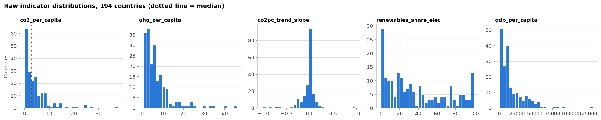

---

## 3. Methodology

### 3.1 Indicators and dimensions

| Dimension (weight) | Indicator | Better when | Notes |
|---|---|---|---|
| Emissions Intensity (25%) | `co2_per_capita`, `ghg_per_capita` | lower | Averaged within the dimension |
| Decarbonization Trajectory (25%) | `co2pc_trend_slope` | more negative | OLS slope of CO2/capita over 2013–2022 (≥ 8 of 10 years required). A slope is used instead of an endpoint difference so that one-off years such as the 2020 COVID dip don't dominate. |
| Energy Transition (25%) | `renewables_share_elec` | higher | Chosen over the energy-wide share for coverage (212 vs 79 of 220 countries). Excludes nuclear. |
| Economic Capacity (25%) | `gdp_per_capita` | higher | GDP ÷ population. This is the indicator with the most missing values. |

### 3.2 Missing data: hierarchical regional imputation

DA1 filled every gap with the global median. That gave Somalia, South Sudan and Eritrea a
GDP per capita of about $12,600, roughly six times the Eastern Africa median. It lifted
Somalia and Eritrea into the *Advancing* tier, and South Sudan to the upper end of
*Emerging*.

The final pipeline fills each gap with the median of the **most specific UN M49 group that
has at least 5 observed values**. It tries the intermediate region first, then the
sub-region, then the region, and falls back to the global median. Group medians are computed
from observed values only.

| Imputed values | Count | Sources |
|---|---|---|
| GDP per capita | 30 | Caribbean (8), Eastern Africa (3), South America (2), Southern Asia (2), South-eastern Asia (2), Central America, Western Africa, Northern Africa, Eastern Asia (1 each), global median (9) |
| GHG per capita | 1 | Palestine, from the Western Asia median |

The nine global-median fallbacks are all Pacific island states. Melanesia, Micronesia and
Polynesia have no observed GDP at all, and their parent region (Oceania) has only Australia
and New Zealand. The fallback deliberately avoids giving Pacific islands Australian incomes.
Every imputed value, and the group it came from, is recorded in the scored table and in
`pipeline_manifest.json`.

### 3.3 Normalization

Each indicator is converted to its **percentile rank** within the 194-country cohort,
oriented so that 0–100 always means worse to better. The raw indicators are heavily skewed
(CO2 per capita ranges from 0.06 to 37.9 t, with skew 2.8). Under min-max scaling, a few
petro-states would push everyone else into a narrow band. The min-max alternative in §5.1
shows the effect: it moves the average country 25 rank places.

The fitted normalizer stores each indicator's reference distribution. A new or hypothetical
country is therefore scored against the same cohort without refitting.

### 3.4 Aggregation and tiers

Dimension scores are averaged with equal weights into the composite index. Equal weighting
is a deliberate, transparent default; no validated expert weighting exists for this
question. Tiers are the composite's quartiles: **Lagging** (49 countries), **Emerging** (48),
**Advancing** (48) and **Leader** (49).

### 3.5 ML cross-check: PCA + KMeans

The five normalized indicators are standardized, projected onto two principal components
(for visualization) and clustered with KMeans. All of this is independent of the index
weights.

- **PCA:** PC1 explains 53.6% of the variance and PC2 21.8%.
- **PC1** contrasts low emissions with high GDP. Its loadings are +0.58 for CO2, +0.52 for
  GHG and −0.54 for GDP, on the "better" orientation.
- **PC2** is mostly renewables (+0.78) and the decarbonization trend (+0.60).
- **Segment labels:** segments are numbered by ascending mean index score so that colours and
  legend order stay stable.

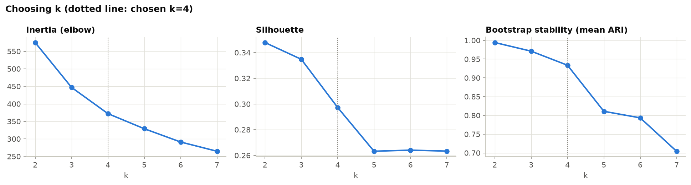

**Choosing k.** The silhouette score falls steadily from k=2 (0.35) to k=5 (0.26), and the
inertia curve has no sharp elbow. The countries form a continuum rather than well-separated
groups. **k = 4 is chosen for comparability with the four tiers, not because the data
strongly favors it.** (The DA1 review described k=4 as "selected" by the elbow and
silhouette analysis; this report corrects that.) Bootstrap refits show the k=4 segments are
nonetheless reproducible (§5.5).

### 3.6 Validation design

The robustness checks follow the uncertainty and sensitivity analysis recommended in the
OECD/JRC *Handbook on Constructing Composite Indicators*. All are implemented in
`src/components/index_validation.py` and rerun on every pipeline build.

1. **Scenario analysis.** There are 12 alternatives, each compared with the baseline.
   - Weight scenarios: drop each dimension (4), and double each dimension (4).
   - Method alternatives:
     - geometric instead of arithmetic aggregation
     - min-max instead of percentile normalization
     - a relative (%/yr) trend instead of the absolute slope
     - global-median instead of regional imputation
2. **Weight sensitivity.** There are 1,000 random weightings, each dimension weight drawn
   uniformly within ±50% of its baseline value and then renormalized. For each country this
   gives the 5th, 50th and 95th percentile rank and the share of draws in which it keeps its
   tier.
   - These ranges describe sensitivity to that *assumed* weight variation. They are not
     statistical confidence intervals.
   - They do not include imputation uncertainty, which item 3 covers.
3. **Imputation sensitivity.** Each imputed value is set to the lowest and the highest
   observed value in the peer group it was imputed from, and the country is re-scored. Other
   countries and the fitted reference distribution are held fixed. The composite is
   monotonic in every indicator, so these two extremes bound the country's score, rank and
   tier.
4. **Tier and segment agreement.** The label-independent metrics are ARI and NMI. The
   position-based metrics are exact and within-one-step agreement, which rely on numbering
   the segments by mean index score.
   - Their chance baseline is a **permutation test** (1,000 permutations): the segment
     labels are shuffled and the shuffled segments re-numbered by mean score in the same way.
   - Countries whose tier and segment differ by two or more steps are listed.
5. **Cluster stability.** KMeans is refitted on 50 random 80% subsamples for each k from
   2 to 7, and each refit is scored (ARI) against the full-data clustering.

---

## 4. Results

### 4.1 Rankings

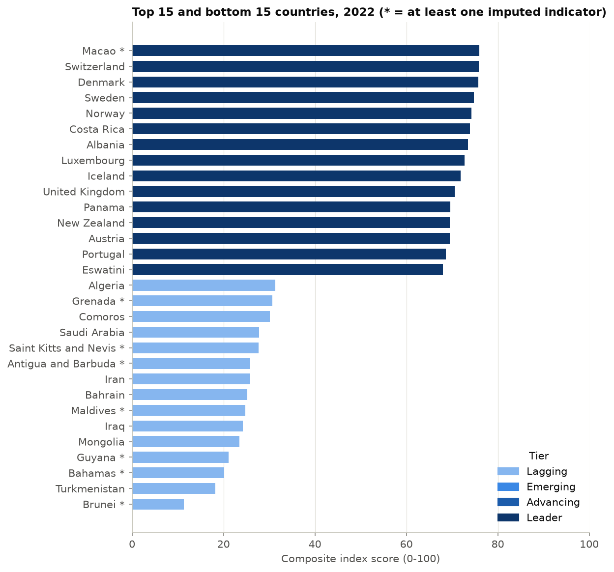

| Rank | Country | Score | Tier | Rank range, weights ±50% | Tier kept, weights ±50% |
|---|---|---|---|---|---|
| 1 | Macao * | 76.0 | Leader | 1–11 | 1.00 |
| 2 | Switzerland | 75.8 | Leader | 1–8 | 1.00 |
| 3 | Denmark | 75.8 | Leader | 1–9 | 1.00 |
| 4 | Sweden | 74.7 | Leader | 3–8 | 1.00 |
| 5 | Norway | 74.2 | Leader | 1–15 | 1.00 |
| 6 | Costa Rica | 73.9 | Leader | 1–16 | 1.00 |
| 7 | Albania | 73.5 | Leader | 1–19 | 1.00 |
| 8 | Luxembourg | 72.7 | Leader | 3–26 | 1.00 |
| 9 | Iceland | 71.9 | Leader | 3–27 | 0.99 |
| 10 | United Kingdom | 70.6 | Leader | 6–25 | 1.00 |

The rank range is the 5th–95th percentile rank across 1,000 random weightings (each
dimension weight ±50%). It is a sensitivity result, not a confidence interval.

\* Macao's GDP is imputed. Varied across its peer group's observed range, Macao could rank
anywhere from 1st to 65th (§5.3). See also the Macao case study (§6).

The top of the ranking consists of high-income economies with clean electricity (hydro,
nuclear or wind) and steadily falling per-capita emissions. The bottom ten are oil and gas
exporters and small fossil-dependent states, ending with Turkmenistan (193) and Brunei
(194). The weight ranges at both ends are narrow: these positions hold under any reasonable
*weighting*.

Weighting is not the only source of uncertainty. Five of the bottom ten have an imputed GDP:
Antigua and Barbuda, the Maldives, Guyana, the Bahamas and Brunei. For Brunei ($8.9k, the
South-eastern Asia median) and the Bahamas ($9.9k, the Caribbean median), the regional median
is well below what these economies actually earn.

The imputation check (§5.3) bounds the effect. Even with GDP at the top of its peer group,
all five stay *Lagging*. Brunei could rise only as high as 185th; it would get there with
Singapore's GDP of $81.7k. Their tier is therefore robust to the imputation, while their
exact positions within the bottom ten are not.

### 4.2 Anchor countries

| Country | Score | Rank (range, weights ±50%) | Tier (share kept) | Emissions | Trajectory | Energy | Economic |
|---|---|---|---|---|---|---|---|
| Sweden | 74.7 | 4 (3–8) | Leader (1.0) | 45 | 84 | 78 | 92 |
| Norway | 74.2 | 5 (1–15) | Leader (1.0) | 17 | 86 | 95 | 99 |
| Iceland | 71.9 | 9 (3–27) | Leader (1.0) | 10 | 88 | 100 | 90 |
| Germany | 67.8 | 16 (10–46) | Leader (1.0) | 19 | 94 | 66 | 92 |
| France | 63.7 | 27 (20–62) | Leader (0.9) | 39 | 81 | 46 | 88 |
| Ethiopia | 62.6 | 29 (8–73) | Leader (0.7) | 91 | 44 | 100 | 15 |
| United States | 60.7 | 40 (21–100) | Leader (0.6) | 5 | 96 | 45 | 97 |
| Nigeria | 53.9 | 81 (52–101) | Advancing (0.9) | 85 | 57 | 47 | 27 |
| Qatar | 51.9 | 89 (37–153) | Advancing (0.4) | 0 | 97 | 10 | 100 |
| India | 39.8 | 153 (135–164) | Lagging (0.8) | 66 | 20 | 41 | 32 |
| China | 36.3 | 174 (136–181) | Lagging (0.9) | 17 | 6 | 53 | 69 |
| Saudi Arabia | 27.8 | 183 (161–189) | Lagging (1.0) | 3 | 4 | 8 | 96 |

The Nordic anchors are robust Leaders, and Saudi Arabia is a robust Lagger. The United
States and Qatar show the weakness of equal weighting. Both have among the worst emissions
intensity in the cohort but are carried by GDP and a steep per-capita decline. Their wide
weight-sensitivity rank ranges (21–100 and 37–153) and low tier stability (0.6 and 0.4) show
that the index itself flags these placements as weight-dependent.

France's moderate energy-transition score reflects the exclusion of nuclear power from the
renewables share.

### 4.3 Regional pattern

| Region | Countries | Mean score | Leaders |
|---|---|---|---|
| Europe | 39 | 59.2 | 23 |
| Oceania | 11 | 53.4 | 2 |
| Americas | 38 | 49.6 | 10 |
| Africa | 55 | 48.5 | 8 |
| Asia | 51 | 44.6 | 6 |

---

## 5. Validation and robustness

### 5.1 Sensitivity to weights and methods

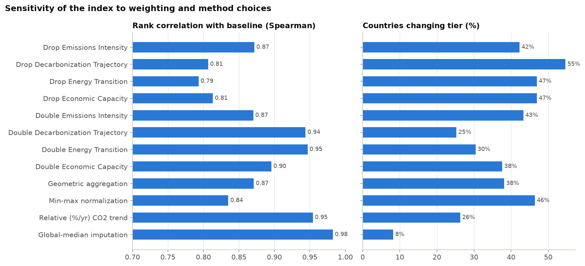

| Scenario | Spearman vs baseline | Mean rank shift | % changing tier | Top-10 overlap |
|---|---|---|---|---|
| Drop Emissions Intensity | 0.872 | 22.5 | 42.3 | 6 |
| Drop Decarbonization Trajectory | 0.807 | 28.4 | 54.6 | 7 |
| Drop Energy Transition | 0.793 | 28.6 | 46.9 | 5 |
| Drop Economic Capacity | 0.813 | 28.3 | 46.9 | 2 |
| Double Emissions Intensity | 0.870 | 23.5 | 43.3 | 5 |
| Double Decarbonization Trajectory | 0.944 | 13.9 | 25.3 | 8 |
| Double Energy Transition | 0.947 | 14.0 | 30.4 | 9 |
| Double Economic Capacity | 0.896 | 19.9 | 37.6 | 8 |
| Geometric aggregation | 0.871 | 20.7 | 38.1 | 7 |
| Min-max normalization | 0.835 | 25.0 | 46.4 | 8 |
| Relative (%/yr) CO2 trend | 0.954 | 12.1 | 26.3 | 9 |
| Global-median imputation | 0.982 | 4.8 | 8.2 | 9 |

**Interpretation:**

- **Every dimension matters.** Dropping any one of them lowers the rank correlation to about
  0.79–0.87.
- **Economic Capacity has the biggest effect on the top of the ranking.** Dropping it keeps
  only 2 of the top 10. Without GDP, low-income countries with very low emissions and
  hydro-based grids (Afghanistan, Uganda, Malawi, Ethiopia, Sierra Leone, Burundi) rise to
  the top. This is the core trade-off between "can afford the transition" and "already emits
  little".
- **Geometric aggregation targets imbalance.** It stops a strong dimension from compensating
  a weak one, so lopsided profiles fall sharply: Qatar drops from 89th to 181st, Kuwait from
  123rd to 184th, and the United States from 40th to 117th.
- **Methodological choices matter as much as weights.** Min-max normalization and geometric
  aggregation each move the average country 20–25 places.
- **Regional imputation is a small, targeted change** (Spearman 0.98). It mainly affects the
  31 countries with an imputed value.

### 5.2 Weight sensitivity: random weights ±50%

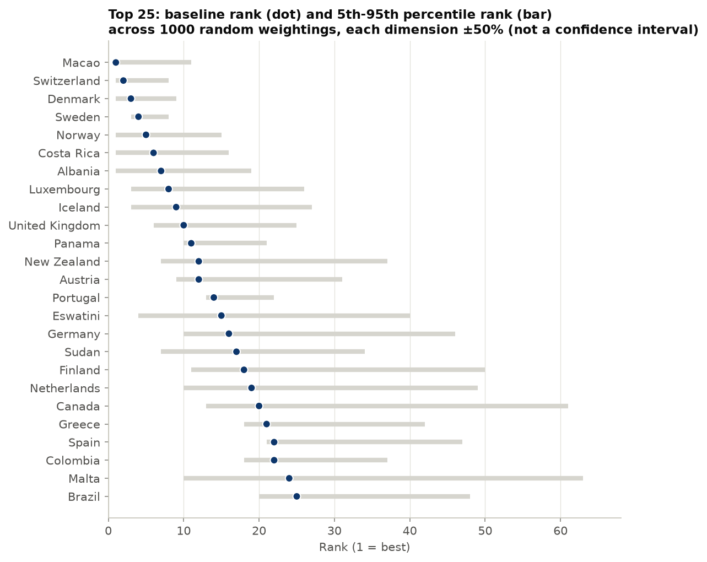

Across 1,000 random weightings, with each dimension weight drawn uniformly within ±50% of
its baseline:

- **Overall correlation:** the ranking correlates with the baseline at a mean Spearman of
  **0.954** (minimum 0.739).
- **Exact positions are soft:** the median width of a country's 5th–95th percentile rank
  range is **48 places**.
- **Middle tiers are fragile:** only **47%** of countries keep their tier in at least 80% of
  draws, and 26% in at least 95%.

These ranges are a sensitivity analysis under an *assumed* amount of disagreement about
weights. They are not statistical confidence intervals: a wider assumed spread would widen
them. They also leave out imputation uncertainty, which §5.3 measures separately.

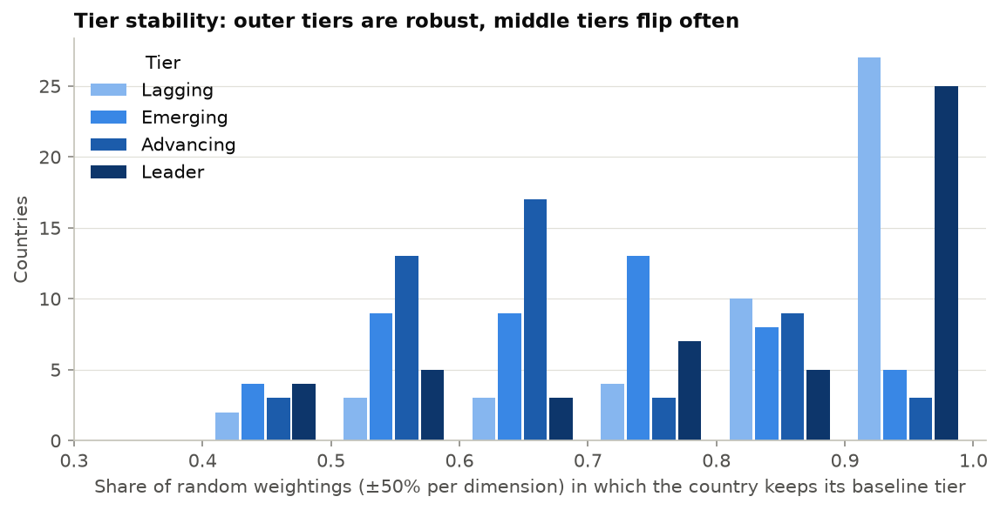

The outer tiers are much more stable than the middle ones, with a mean tier stability of
0.87 for Lagging and 0.83 for Leader, against 0.71 for Emerging and 0.67 for Advancing.
Outer-tier countries can only slip in one direction.

**Practical reading:** the index is reliable for statements like "Sweden is among the
leaders" or "Saudi Arabia is lagging". It is not reliable for "Germany ranks 16th, ahead of
the Netherlands". The dashboard therefore shows, next to each score, the country's
weight-sensitivity rank range and tier stability, both labelled with the ±50% assumption.
For imputed countries it also shows the imputation range (§5.3).

### 5.3 Imputation sensitivity

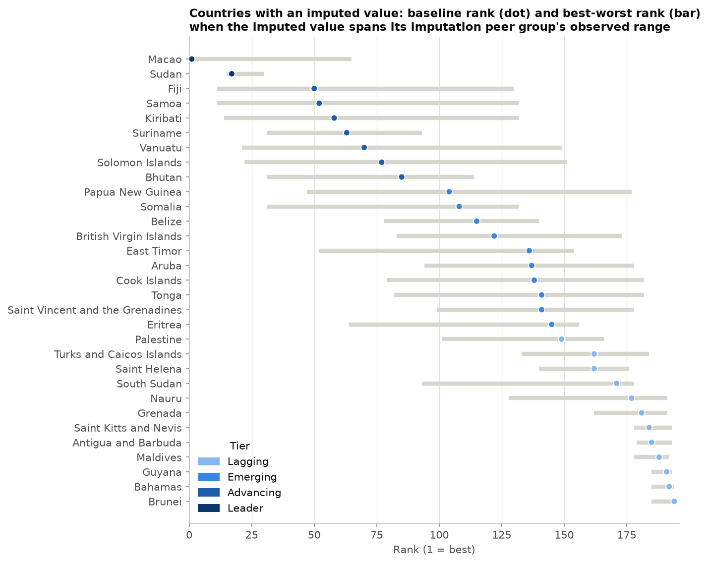

Each of the 31 imputed values was set to the lowest and the highest observed value in the
peer group it came from. For GDP that means the countries of the same UN region; for the
Pacific islands it means all 164 countries with observed GDP ($689–$131,991). Each country
was then re-scored against the fixed cohort.

- **Tier uncertainty is common:** **23 of 31** imputed countries could change tier, and the
  median rank range is **79 places**.
- **The Pacific islands are essentially unplaceable.** Fiji, Samoa, Kiribati, Vanuatu, the
  Solomon Islands and Papua New Guinea each span 100 or more places, because no regional
  peer has observed GDP.
- **Macao's #1 rests on its imputed GDP.** It could rank anywhere from 1st to 65th
  (Leader or Advancing).
- **Some placements hold regardless.** The eight countries whose tier cannot change include
  all five imputed bottom-ten countries (Antigua and Barbuda, the Maldives, Guyana, the
  Bahamas, Brunei) plus Grenada, Saint Kitts and Nevis, and Sudan.

This is a deliberately wide, one-at-a-time bound. It is not a probability statement, and it
holds the other 193 countries fixed. It is reported separately from the weight ranges in
§5.2, and the two should not be combined.

### 5.4 Do the KMeans segments agree with the tiers?

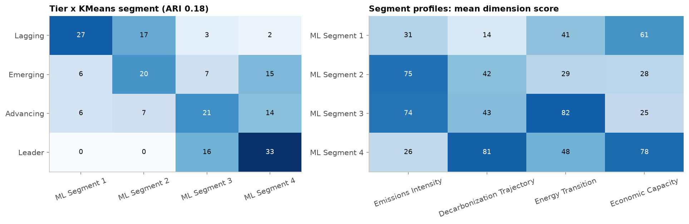

| Metric | Value | Chance level |
|---|---|---|
| Adjusted Rand Index | 0.179 | 0 by construction |
| Normalized mutual information | 0.240 | ≈ 0 |
| Exact agreement (tier position = segment position) | 52.1% | 27.7% (permutation; 95th pct 32.5%; p < 0.001) |
| Within one step | 86.6% | 66.2% (permutation; p < 0.001) |
| Spearman (tier vs segment order) | 0.641 | — |

ARI and NMI are the primary measures because they don't depend on how the segments are
numbered. The position-based measures do depend on it. Segments are numbered by ascending
mean index score, and that ordering alone lines random segments up with the tiers more
often than the naive 25%. The chance level therefore comes from 1,000 permutations: the
segment labels are shuffled and re-numbered the same way. Observed agreement is well above
that baseline, but moderate.

The segment profiles explain the moderate agreement: KMeans separates countries by
**development profile**, while the tiers rank overall readiness.

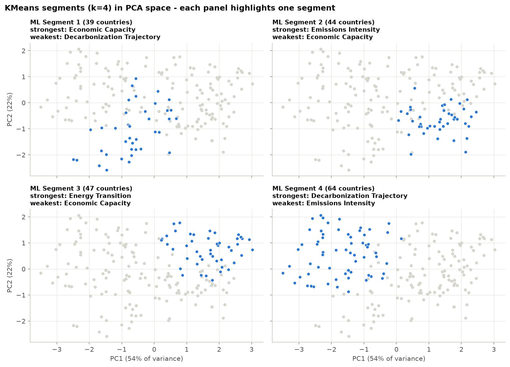

| Segment | Countries | Profile (mean dimension scores) | Dominant tier |
|---|---|---|---|
| 1 | 39 | Mid-to-high income, emissions not falling (trajectory 14) | Lagging |
| 2 | 44 | Low emissions, low income, fossil-heavy grids (energy 29, economic 28) | Emerging |
| 3 | 47 | Low emissions, clean grids, low income (energy 82, economic 25) | Advancing |
| 4 | 64 | High income, high emissions, falling fast (trajectory 81, economic 78) | Leader |

Of the 26 countries whose tier and segment are two or more steps apart, 15 are *Emerging*
countries placed in Segment 4. These are wealthy, fossil-heavy economies such as Kuwait,
Oman, Singapore, Taiwan and Trinidad and Tobago. They share Segment 4's income and
improving-trend profile, but the index ranks them lower because of their emissions and
energy mix. **The disagreement is informative rather than an error.** The clustering groups
countries by what they look like, while the index judges how ready they are. Segment 4
mixing genuine leaders with petro-economies is exactly the distinction the composite index
is designed to draw.

### 5.5 Are the segments stable?

Refitting KMeans on 50 random 80% subsamples reproduces the full-data k=4 segmentation with
a **mean ARI of 0.93** (5th percentile 0.82). Stability declines with k: 0.99 at k=2, 0.97
at k=3, 0.81 at k=5 and 0.70 at k=7. So the four segments are a reproducible feature of the
data, even though they are not sharply separated (silhouette 0.30).

### 5.6 Does the trend measure favor high emitters?

The absolute slope (t/yr) could favor high emitters, simply because they have more tonnes
available to cut. Its decarbonization score does correlate mildly with emissions level
(Spearman **0.24**). However, a relative (%/yr) trend correlates *more* strongly (**0.40**)
and barely changes the ranking (Spearman 0.954 vs baseline). The pattern is therefore real
convergence rather than a scaling artifact: high-income countries cut per-capita CO2 over
2013–2022 while many developing economies grew it. The absolute slope is kept.

### 5.7 Effect of regional imputation

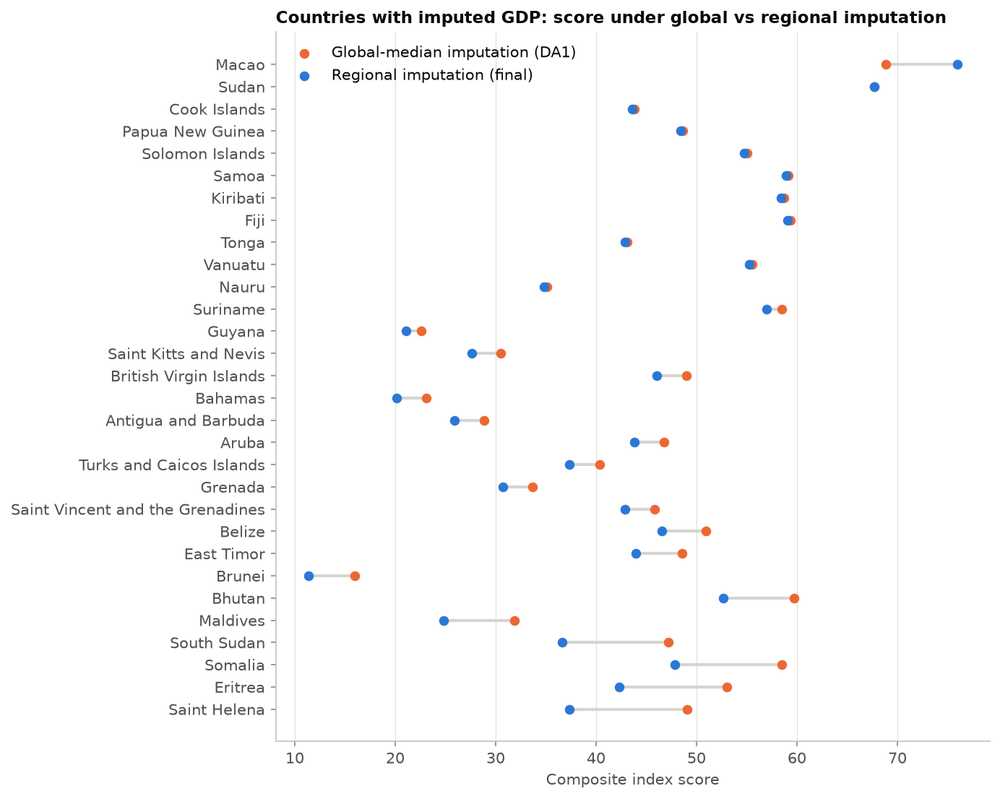

Regional imputation lowered the scores of the poorest imputed countries by about 10–12
points (Saint Helena, Eritrea, Somalia, South Sudan). Each fell one tier. It raised Macao by
7 points. Pacific islands are essentially unchanged, because they still use the global
median.

---

## 6. Case studies

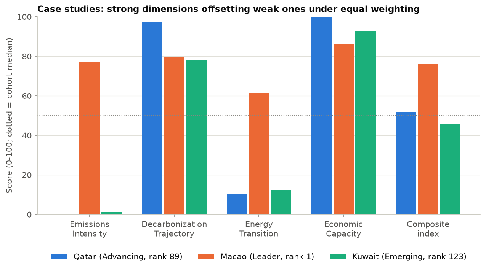

- **Qatar (Advancing, rank 89, tier stability 0.4).** Qatar has the cohort's worst emissions
  intensity (score 0) and a fossil-gas grid (energy score 10). It still lands mid-table
  because it has the highest GDP per capita (100) and a steep per-capita decline (97). That
  decline is partly a population-growth effect. This is the textbook case of compensability
  in an arithmetic composite. Under geometric aggregation, which penalizes imbalance, Qatar
  falls to 181st. The dashboard's Scenario Lab lets users test weightings directly.
- **Macao (Leader, rank 1).** Macao imports most of its electricity from mainland China, and
  OWID emissions are counted territorially (production-based), so its domestic CO2 per
  capita is only 1.5 t. Its GDP is also imputed, from the Eastern Asia median of $38k. Both
  are data-accounting effects, not evidence of exceptional readiness. Macao is kept in the
  cohort, consistent with the country-inclusion rules, and is flagged in the dashboard and in
  this report.
- **Kuwait (Emerging, rank 123).** Kuwait is a strong tier/segment disagreement: KMeans
  groups it with the high-income Leaders of Segment 4. The index places it lower because its
  emissions intensity (score 1) and energy mix (12) offset its income and improving trend.

---

## 7. Dashboard

`streamlit run app.py` opens six pages:

1. **Overview / Ranking.** A world map, region and tier filters, and a ranking table. The
   table shows the weight-sensitivity rank range and tier stability (both labelled "weights
   ±50%") and, for imputed countries, a separate imputation rank range. It can be
   downloaded as CSV.
2. **Country Detail.** Raw indicators, an indicator radar against the regional and global
   medians, dimension scores against regional peers, and a peer table. Imputed values are
   marked with their source and their peers' observed range, plus a warning giving the
   imputation rank range.
3. **Scenario Lab.**
   - Four sliders re-weight the dimensions live and show rank correlation, tier changes and
     the biggest climbers and fallers.
   - A what-if scorer runs any set of raw indicator values through the fitted model, without
     refitting. For example, giving India a 50%-renewable grid lifts its score from 39.8
     (Lagging) to 46.7 (Emerging).
   - **Input checks:** values must be finite and physically possible. CO2 per capita must be
     ≥ 0, renewables share between 0 and 100%, and GDP per capita at least $1. The widgets
     enforce these bounds, and the prediction pipeline rejects violations with a named error
     instead of scoring them.
   - **GHG per capita has no lower bound.** OWID's GHG series includes land use, so net
     forest sinks make it legitimately negative (488 country-years in the raw data).
4. **Robustness & Validation.** Everything in §5, computed from the pipeline manifest.
5. **PCA & Clusters.** A biplot coloured by tier, segment small multiples, loadings, and the
   inertia and silhouette curves.
6. **Methodology & Limitations.** Includes a build-provenance panel: input hashes, merge
   coverage, dropped countries with the indicators they lacked, and the audit checks that
   passed.

Before loading, the dashboard checks that every artifact exists, matches the hash recorded
when it was built, and comes from the current raw inputs and configuration (§10). If any
check fails, it rebuilds.

Chart colours use a single-hue ordinal ramp for tiers and a sequential blue scale for scores.
Both were checked for colour-vision-deficiency separation and contrast; red/green encodings
were deliberately avoided.

---

## 8. Limitations

1. **Fine-grained ranks are weight-dependent** (§5.2). Use tiers and rank ranges. The
   ranges reflect an assumed ±50% weight variation and are not confidence intervals.
2. **Territorial emissions accounting** flatters territories that import much of their
   electricity (Macao, Hong Kong) relative to their consumption footprint.
3. **Imputation carries its own, larger uncertainty** (§5.3), which the weight ranges do not
   include. 23 of the 31 imputed countries could change tier within their peers' observed
   range, and the Pacific islands cannot be placed with confidence at all. A regional median
   can sit far from a country's true income in either direction:
   - Brunei and the Bahamas are understated, though both stay *Lagging* even at the top of
     their peer range.
   - Sudan takes the Northern Africa median, driven by Libya, Algeria and Egypt, which likely
     overstates its income.
   - Saint Helena takes the Western Africa median.
4. **Renewables share excludes nuclear**, which understates nuclear-heavy low-carbon grids
   (France, Sweden).
5. **Equal weights are a default, not a consensus.** They allow compensation between
   dimensions, as the Qatar and US cases show.
6. **A single cross-section (2022)** with only the trend dimension looking back. The index is
   not longitudinal.
7. **No policy or pledge-ambition dimension.** Candidate sources, such as national net-zero
   target trackers and NDC databases, record *declared* targets as categorical status rather
   than measured outcomes. They would need their own coverage and licensing audit, and adding
   one would change the four-dimension index design. This was considered and left as future
   work.
8. **Clusters are not readiness classes** (§5.4), and their silhouette is weak (0.30).

---

## 9. Changes since the DA1 progress review

| DA1 "remaining work" item | Outcome |
|---|---|
| Sensitivity analysis across alternative weightings | Done: 12 scenarios plus a 1,000-draw weight sensitivity analysis, with per-country rank ranges and tier stability (§5.1–5.2) |
| Deeper validation of tier ↔ cluster agreement | Done: ARI/NMI, a permutation chance baseline, segment profiles, disagreement analysis and bootstrap stability (§5.4–5.5) |
| Dashboard polish + live re-weighting sliders | Done: 6 pages, including the Scenario Lab sliders and the input-validated what-if scorer (§7) |
| Region-aware missing-data imputation | Done: hierarchical UN M49 medians (§3.2), plus an imputation-sensitivity check (§5.3) |
| Full methodology write-up and final report | This document |
| Broader testing and reproducibility checks | Done: 73 tests, a data audit, a build fingerprint and artifact freshness checks (§10) |
| Explore a policy/pledge-ambition proxy | Considered and deferred (§8.7) |

**Corrections to DA1:**

- **Choice of k:** k=4 is now described as chosen for comparability with the tiers, not
  selected by the silhouette score (§3.5).
- **Rankings:** DA1's top-5 (Switzerland, Denmark, Sweden, Norway, Costa Rica) is unchanged
  apart from Macao entering at #1 after regional imputation.
- **Bug fix:** hypothetical countries scoring outside the cohort's range previously received
  no tier. Now they fall into the outer tiers.

---

## 10. Reproducibility

```bash
python -m src.pipeline.train_pipeline     # rebuild all artifacts (about 15 s)
python -m pytest                          # 73 tests (about 25 s)
streamlit run app.py                      # dashboard (rebuilds stale artifacts automatically)
python reports/build_report_charts.py     # regenerate this report's charts
```

- **Data audit.** Every build checks the inputs and fails with a message naming the
  offending rows if any check fails:
  - each raw file has its required columns
  - no country has two rows for the same year
  - the UN region codes are unique
  - the CO2/energy, trend and region merges are one-to-one
  - every indicator value is finite and within its physical bounds

  The manifest records each file's row count and SHA-256 hash, the countries lost in the
  CO2/energy merge (12 only in the CO2 file, 14 only in the energy file), the missing-value
  counts before imputation, and each dropped country with the indicators it lacked.
- **Build fingerprint and freshness.** The manifest stores a fingerprint of the three raw
  inputs and every configuration constant, plus the hash of each artifact the build wrote.
  A changed source file, changed weight or setting, missing pickle, or artifact from a
  different build is detected and triggers a rebuild in the dashboard. Each case is tested.
- **Determinism.** The pipeline uses fixed seeds. A test re-runs it and checks that the
  scored table and every validation statistic are identical.
- **Train/predict consistency.** A second test scores all 194 countries through
  `PredictPipeline` and confirms that the scores (to within 1e-9), tiers and segments match
  training.
- **Source of truth for numbers.** Every figure in this report comes from
  `artifacts/pipeline_manifest.json` and `artifacts/netzero_indicators_2022.csv`.

---

## 11. Conclusion

NetZeroAI shows that a small, transparent composite index built on open data can separate
clear net-zero leaders from clear laggards, robustly across reasonable methodological
choices. The project's most useful contribution beyond the index is the uncertainty
reporting: every score comes with a weight-sensitivity rank range and tier stability, and
every imputed country with a separate imputation range. Users can therefore see when a
placement depends on contestable weighting choices, such as the United States in *Leader*
or Qatar in *Advancing*, and when it depends on a missing value, such as Macao at #1. The unsupervised layer complements
the index. It does not confirm the tiers one-for-one; instead it shows that countries differ
mainly along an income-versus-emissions axis, which the index then resolves into a judgement
of readiness.

**Future work:**

- a consumption-based emissions variant
- a nuclear-inclusive low-carbon electricity share
- a properly audited policy-ambition dimension
- a multi-year panel to track readiness over time

---

## References

- Our World in Data. *CO2 and Greenhouse Gas Emissions dataset*. https://github.com/owid/co2-data
- Our World in Data. *Energy dataset*. https://github.com/owid/energy-data
- United Nations Statistics Division. *Standard country or area codes for statistical use (M49)*. https://unstats.un.org/unsd/methodology/m49/
- lukes (GitHub). *ISO-3166 Countries with Regional Codes*, `all/all.csv` at commit 145f1ad. https://github.com/lukes/ISO-3166-Countries-with-Regional-Codes
- OECD / European Commission Joint Research Centre (2008). *Handbook on Constructing Composite Indicators: Methodology and User Guide*. OECD Publishing, Paris.
- Hubert, L. & Arabie, P. (1985). Comparing partitions. *Journal of Classification*, 2, 193–218.
- Pedregosa, F. et al. (2011). Scikit-learn: Machine Learning in Python. *JMLR*, 12, 2825–2830.
